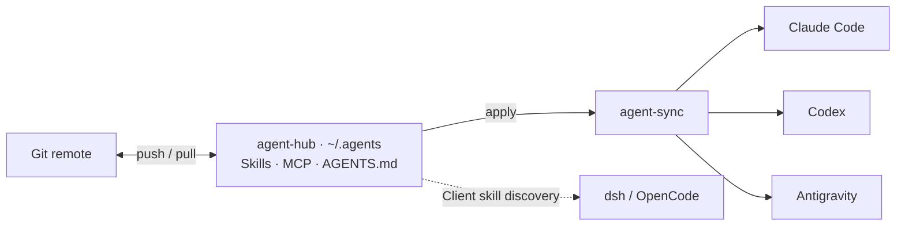

<div align="center">

# agent-hub

**One configuration. Multiple agents. Across your machines.**

Keep your skills, MCP server configuration, and global rules in one Git repository.<br>
Use `agent-sync` to distribute them to your coding tools and carry your setup to another machine.

[简体中文](README.md) · English

[Quick start](#quick-start) · [Featured skills](#featured-skills) · [Usage guide](docs/usage.md) · [Project description](docs/project-introduction.md)

</div>

## Why agent-hub

Working with several coding agents often means maintaining the same rules, skills, and MCP servers in several configuration directories. Moving to another machine adds another round of path fixes and dependency setup.

agent-hub keeps reusable assets in `~/.agents`. Git manages the source files; a script handles the tool-specific configuration.

- **One place to edit**: maintain skills, global `AGENTS.md` rules, and MCP declarations in the Hub.
- **Distribution across tools**: link skills and rules into Claude Code, Codex, and Antigravity, and generate their MCP configuration.
- **Reuse across machines**: pull your repository and apply it locally. Interpreter paths, credentials, and local state stay on each machine.
- **Checks you can run**: inspect with `scan`, preview with `apply --dry-run`, and check MCP handshakes, skill counts, and rule links with `doctor`.
- **Reusable workflows**: skills cover discovery, prototypes, product planning, implementation, review, browser testing, and reverse engineering.

The sync tool itself uses only the Python standard library. MCP servers and individual skills can require additional software.

## How it works



Edit the source in the Hub. Run `apply` after adding or removing skills or changing MCP declarations. Git transfers repository content between machines; `agent-sync` handles configuration on the current machine.

## Quick start

You need **Git, Python 3.11+**, and an environment that supports symbolic links. These commands follow Linux / macOS path and shell conventions.

### 1. Get the repository

```bash
git clone https://github.com/abcde55555/agent-hub.git "$HOME/.agents"
python3 "$HOME/.agents/bin/agent-sync" scan
```

If `~/.agents` already exists, inspect it before updating or adopting its contents. Fork the repository and use your own remote if you plan to maintain a personal setup.

### 2. Make it yours

- [AGENTS.md](AGENTS.md): replace the global rules with your own.
- [mcp/servers.json](mcp/servers.json): select your servers, endpoints, `targets`, and dependencies. The checked-in preset includes the maintainer's service configuration.
- [skills/](skills/): inspect the available workflows and their tool requirements.

**To try skills and global rules first**, start with this `mcp/servers.json` and add servers later:

```json
{
  "version": 1,
  "mcpServers": {}
}
```

If you keep MCP servers, configure their dependencies and local variables first. The bundled `browser-use` server needs a separate local npm install and browser download. See [MCP setup](docs/usage.md#mcp-配置) in the Chinese usage guide.

### 3. Preview, apply, and check

```bash
python3 "$HOME/.agents/bin/agent-sync" apply --dry-run
python3 "$HOME/.agents/bin/agent-sync" apply
python3 "$HOME/.agents/bin/agent-sync" doctor
```

By default, `apply` writes configuration paths for Claude Code, Codex, and Antigravity. Use `apply --targets claude,codex` to select a subset. `doctor` still runs its full set of checks. Restart the relevant client sessions after applying, then try a skill.

## Distribution scope

These are the paths managed by the current script. Whether a skill runs successfully also depends on the client's version, permissions, and available tools.

| Tool | Skills | Global rules | MCP configuration |
| --- | --- | --- | --- |
| Claude Code | Links in `~/.claude/skills/` | `~/.claude/CLAUDE.md` | Merge into `~/.claude.json` |
| Codex | Links in `~/.codex/skills/` | `~/.codex/AGENTS.md` | Managed region in `~/.codex/config.toml` |
| Antigravity (agy) | Links in `~/.gemini/config/skills/` | `~/.gemini/config/AGENTS.md` | Merge into `~/.gemini/config/mcp_config.json` |
| dsh / OpenCode | Rely on client discovery of `~/.agents/skills/` | Loaded by the client | No MCP configuration generator currently implemented |

## Featured skills

Choose a skill by the task you want to complete. Its `SKILL.md` defines the workflow, requirements, and limits.

| Task | Start here |
| --- | --- |
| Take over a project and turn trial feedback into actionable work | [codex-product-planner](skills/codex-product-planner/SKILL.md) |
| Execute a work package or review a fixed candidate | [codex-product-worker](skills/codex-product-worker/SKILL.md) |
| Clarify an idea and build an interactive prototype | [grilling](skills/grilling/SKILL.md) · [prototype](skills/prototype/SKILL.md) |
| Turn a discussion into a specification and tickets | [to-spec](skills/to-spec/SKILL.md) · [to-tickets](skills/to-tickets/SKILL.md) |
| Implement, test, and review changes | [implement](skills/implement/SKILL.md) · [tdd](skills/tdd/SKILL.md) · [code-review](skills/code-review/SKILL.md) |
| Diagnose bugs and resolve Git conflicts | [diagnosing-bugs](skills/diagnosing-bugs/SKILL.md) · [resolving-merge-conflicts](skills/resolving-merge-conflicts/SKILL.md) |
| Define domain terms and module boundaries | [domain-modeling](skills/domain-modeling/SKILL.md) · [codebase-design](skills/codebase-design/SKILL.md) |
| Operate a browser and verify user flows through the UI | [browser-use](skills/browser-use/SKILL.md) · [web-gui-tester](skills/web-gui-tester/SKILL.md) |
| Inspect APKs, binaries, firmware, and cryptographic implementations | [reverse-engineering](skills/reverse-engineering/SKILL.md) |
| Research primary sources, prepare handoffs, and write agent documentation | [research](skills/research/SKILL.md) · [handoff](skills/handoff/SKILL.md) · [writing-for-agents](skills/writing-for-agents/SKILL.md) |

Browse [skills/](skills/) for the full collection. The Codex product skills use Codex collaboration capabilities; linking them into another client does not automatically adapt those capabilities.

### Example: generate an overview of an existing project

In a Codex project chat with the skill loaded:

```text
Use $codex-product-planner to generate or refresh an HTML overview of this project,
using the existing documentation and development workflow.
```

The skill organizes goals, capabilities, roadmap, current work, and evidence into `docs/ai-workflow/overview/index.html`. This is a static snapshot refreshed on demand. Technical verification, user acceptance, and release status are tracked separately.

## Everyday use

```bash
# Inspect the current setup
python3 "$HOME/.agents/bin/agent-sync" scan

# Apply changes to skills, AGENTS.md, or MCP declarations
python3 "$HOME/.agents/bin/agent-sync" apply --dry-run
python3 "$HOME/.agents/bin/agent-sync" apply

# Pull committed changes on another machine
git -C "$HOME/.agents" pull --ff-only
python3 "$HOME/.agents/bin/agent-sync" apply
python3 "$HOME/.agents/bin/agent-sync" doctor
```

| Command | Purpose |
| --- | --- |
| `init` | Create Hub directories and vendor the sync script |
| `scan` | Read-only inventory of the Hub and tool configuration |
| `ingest` | Adopt existing Claude configuration and global skills; moves skills and attempts a Git commit |
| `apply` | Create links, update managed MCP configuration, and remove some retired managed entries |
| `deps` / `deps --install` | Check declared dependencies; attempt supported installations with `--install` |
| `doctor` | Run MCP `initialize` handshakes and check skill counts and rule links |

Adoption, dependencies, `bootstrap.sh`, and current limitations are covered in the [Chinese usage guide](docs/usage.md).

## Repository layout

```text
agent-hub/
├── AGENTS.md               # Global working rules
├── bin/agent-sync          # Configuration sync and checks
├── bootstrap.sh            # New-machine setup entry point
├── mcp/
│   ├── servers.json        # MCP transport / targets / requires declarations
│   └── browser-use/        # Bundled browser MCP implementation
├── skills/                 # Skill entry points and supporting files
├── manifest.json           # Asset inventory snapshot
└── docs/                   # Usage, project descriptions, and README research
```

Ignore rules cover `local.env`, `secrets.env`, `.sync-state.json`, `.venv/`, and `node_modules/`. Credentials, login state, and conversation history remain local to their tools and machines.

## Maintenance and contributions

Add skills under `skills/<name>/SKILL.md` with their scope, workflow, and requirements. Declare new MCP servers, targets, and dependencies in `mcp/servers.json`. Before submitting changes, check documentation links, inspect `apply --dry-run`, and run `doctor` where the configured services are available.

When reporting an issue, include tool versions, reproduction steps, expected and actual results, and redacted check output. Known gaps and verification limits are listed in the [usage guide](docs/usage.md#使用范围与边界).

## Sources and licensing

The repository brings together skills, adaptations, and configuration tooling. Check the source and usage terms of each component separately. There is currently no root `LICENSE` file, so this README does not assign a single open-source license to the whole repository.

The README structure draws on [Anthropic Skills](https://github.com/anthropics/skills), [Superpowers](https://github.com/obra/superpowers), and [Vercel Skills](https://github.com/vercel-labs/skills). See the [reference notes](docs/research/readme-references.md) for observations and sources.
