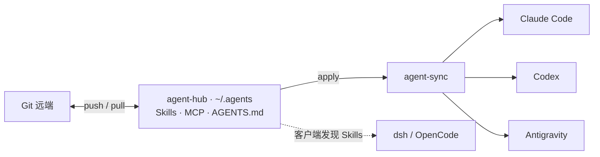

<div align="center">

# agent-hub

**一套配置，多个 Agent，多台设备。**

把 Skills、MCP 服务配置和全局规则放进一个 Git 仓库，<br>
用 `agent-sync` 分发到编程助手，让积累的工作方式随设备一起迁移。

简体中文 · [English](README.en.md)

[快速开始](#快速开始) · [精选技能](#精选技能) · [使用指南](docs/usage.md) · [项目介绍](docs/project-introduction.md)

</div>

## 为什么需要 agent-hub

同时使用几个 AI 编程助手时，同一条规则、一个 MCP 服务、一套技能，往往要在不同目录里维护多份。换一台机器，又要重新找配置、补路径、装依赖。

agent-hub 将这些可复用资产集中到 `~/.agents`：内容通过 Git 管理，工具差异交给脚本处理。

- **集中维护**：Skills、全局 `AGENTS.md`、MCP 声明各有一份正本。
- **跨工具分发**：为 Claude Code、Codex 和 Antigravity 创建技能与规则链接，并生成对应的 MCP 配置。
- **跨设备复用**：在另一台机器拉取仓库，再应用配置；解释器、凭据和本机状态留在各自设备上。
- **有检查入口**：`scan` 查看现状，`apply --dry-run` 预览同步，`doctor` 检查 MCP 握手、技能数量与规则链接。
- **携带工作流程**：技能覆盖需求澄清、原型、产品规划、实现、审查、浏览器测试和逆向分析。

`agent-sync` 本身是一个只使用 Python 标准库的脚本；所连接的 MCP 服务和技能可以有各自的运行依赖。

## 如何工作



平时修改 Hub 中的正本；增减技能或调整 MCP 后重新 `apply`。Git 负责在设备之间传递仓库内容，`agent-sync` 负责本机配置。

## 快速开始

需要 **Git、Python 3.11+**，以及支持符号链接的环境。以下命令使用 Linux / macOS 的目录与 Shell 约定。

### 1. 获取仓库

```bash
git clone https://github.com/abcde55555/agent-hub.git "$HOME/.agents"
python3 "$HOME/.agents/bin/agent-sync" scan
```

如果已有 `~/.agents`，先检查其中内容，再决定更新或迁入。需要维护自己的配置时，建议 Fork 后使用自己的仓库地址。

### 2. 调整为自己的配置

- [AGENTS.md](AGENTS.md)：改成自己的全局工作规则。
- [mcp/servers.json](mcp/servers.json)：保留需要的服务，调整地址、`targets` 和依赖；仓库内的预设包含维护者的服务配置。
- [skills/](skills/)：查看需要复用的技能，以及它们要求的工具。

**只想先体验 Skills 和全局规则**，可先将 `mcp/servers.json` 改为以下内容，之后再添加服务：

```json
{
  "version": 1,
  "mcpServers": {}
}
```

保留 MCP 时，先完成服务依赖和本机变量配置。`browser-use` 需要单独安装本地 npm 依赖与浏览器，步骤见 [MCP 配置](docs/usage.md#mcp-配置)。

### 3. 预览、应用、检查

```bash
python3 "$HOME/.agents/bin/agent-sync" apply --dry-run
python3 "$HOME/.agents/bin/agent-sync" apply
python3 "$HOME/.agents/bin/agent-sync" doctor
```

默认写入 Claude Code、Codex、Antigravity 三套配置路径。仅同步部分工具时，可使用 `apply --targets claude,codex`；`doctor` 仍按自身的完整检查范围运行。应用后重启相关客户端会话，再试用一项技能。

## 分发范围

下表描述当前脚本实际管理的路径。具体技能能否运行，还取决于客户端版本、工具权限和技能依赖。

| 工具 | Skills | 全局规则 | MCP 配置 |
| --- | --- | --- | --- |
| Claude Code | 链接到 `~/.claude/skills/` | `~/.claude/CLAUDE.md` | 合并 `~/.claude.json` |
| Codex | 链接到 `~/.codex/skills/` | `~/.codex/AGENTS.md` | `~/.codex/config.toml` 的受管区域 |
| Antigravity（agy） | 链接到 `~/.gemini/config/skills/` | `~/.gemini/config/AGENTS.md` | 合并 `~/.gemini/config/mcp_config.json` |
| dsh / OpenCode | 按客户端原生发现 `~/.agents/skills/` 的约定复用 | 由客户端加载规则 | 当前无 MCP 配置生成适配器 |

## 精选技能

从任务出发选择技能，具体入口、约束和依赖以各自的 `SKILL.md` 为准。

| 想完成什么 | 可以从这里开始 |
| --- | --- |
| 接手已有项目，把试用反馈变成下一步工作 | [codex-product-planner](skills/codex-product-planner/SKILL.md) |
| 执行明确工作包，或审查固定候选版本 | [codex-product-worker](skills/codex-product-worker/SKILL.md) |
| 先讨论清楚想法，再做可操作原型 | [grilling](skills/grilling/SKILL.md) · [prototype](skills/prototype/SKILL.md) |
| 把讨论整理成规格与任务 | [to-spec](skills/to-spec/SKILL.md) · [to-tickets](skills/to-tickets/SKILL.md) |
| 实现、测试和审查改动 | [implement](skills/implement/SKILL.md) · [tdd](skills/tdd/SKILL.md) · [code-review](skills/code-review/SKILL.md) |
| 排查故障，处理 Git 冲突 | [diagnosing-bugs](skills/diagnosing-bugs/SKILL.md) · [resolving-merge-conflicts](skills/resolving-merge-conflicts/SKILL.md) |
| 梳理业务术语和模块边界 | [domain-modeling](skills/domain-modeling/SKILL.md) · [codebase-design](skills/codebase-design/SKILL.md) |
| 操作浏览器、从用户界面验证流程 | [browser-use](skills/browser-use/SKILL.md) · [web-gui-tester](skills/web-gui-tester/SKILL.md) |
| 分析 APK、二进制、固件与加密实现 | [reverse-engineering](skills/reverse-engineering/SKILL.md) |
| 检索一手资料、整理交接、编写 Agent 文档 | [research](skills/research/SKILL.md) · [handoff](skills/handoff/SKILL.md) · [writing-for-agents](skills/writing-for-agents/SKILL.md) |

完整内容见 [skills/](skills/)。其中 Codex 产品规划与执行技能使用 Codex 的协作能力；链接到其他客户端，并不代表这些能力会自动获得适配。

### 示例：为已有项目生成全景

在已加载技能的 Codex 项目聊天中输入：

```text
使用 $codex-product-planner，为当前项目生成或刷新 HTML 全景，
沿用现有资料和开发流程。
```

规划技能会按约定整理目标、能力、路线、当前工作与证据，生成 `docs/ai-workflow/overview/index.html`。页面是按需刷新的静态快照；技术验证、用户接受与发布状态分别记录。

## 日常使用

```bash
# 查看当前配置
python3 "$HOME/.agents/bin/agent-sync" scan

# 修改 Skills、AGENTS.md 或 MCP 声明后同步
python3 "$HOME/.agents/bin/agent-sync" apply --dry-run
python3 "$HOME/.agents/bin/agent-sync" apply

# 在另一台设备拉取已提交的配置
git -C "$HOME/.agents" pull --ff-only
python3 "$HOME/.agents/bin/agent-sync" apply
python3 "$HOME/.agents/bin/agent-sync" doctor
```

| 命令 | 用途 |
| --- | --- |
| `init` | 建立 Hub 目录骨架，并放入同步脚本 |
| `scan` | 只读盘点 Hub 与各工具配置 |
| `ingest` | 从既有 Claude 配置及全局技能中归集资产；会移动技能并尝试 Git 提交 |
| `apply` | 创建链接、更新受管 MCP 配置、清理部分已下线的受管项 |
| `deps` / `deps --install` | 检查声明依赖；带 `--install` 时尝试安装可处理的依赖 |
| `doctor` | 对声明的 MCP 执行 `initialize` 握手，并检查技能数量和规则链接 |

首次归集、依赖安装、`bootstrap.sh` 和已知边界见 [使用指南](docs/usage.md)。

## 仓库结构

```text
agent-hub/
├── AGENTS.md               # 全局工作规则
├── bin/agent-sync          # 配置同步与检查工具
├── bootstrap.sh            # 新设备初始化入口
├── mcp/
│   ├── servers.json        # MCP 声明：transport / targets / requires
│   └── browser-use/        # 随仓库携带的浏览器 MCP 实现
├── skills/                 # 技能入口与配套资料
├── manifest.json           # 资产清单快照
└── docs/                   # 使用指南、项目介绍与文档参考
```

`local.env`、`secrets.env`、`.sync-state.json`、`.venv/` 和 `node_modules/` 已列入忽略规则。本机凭据、登录状态和会话历史各自保留。

## 维护与贡献

新增技能时，在 `skills/<name>/SKILL.md` 写明适用场景、操作流程和依赖；新增 MCP 时，在 `mcp/servers.json` 声明目标与运行要求。提交前检查文档链接、`apply --dry-run` 的计划，以及可用环境中的 `doctor` 结果。

问题反馈请附工具名称与版本、操作步骤、预期与实际结果，以及脱敏后的检查输出。当前仓库快照的已知缺口和验证范围见 [使用范围与边界](docs/usage.md#使用范围与边界)。

## 来源与许可

本仓库汇集技能、适配内容与配置工具，各项内容的来源和使用条件应分别核对。当前根目录尚无统一 `LICENSE`，这里不声明仓库整体采用某一开源许可证。

README 的组织方式参考了 [Anthropic Skills](https://github.com/anthropics/skills)、[Superpowers](https://github.com/obra/superpowers) 和 [Vercel Skills](https://github.com/vercel-labs/skills)。具体观察与来源见 [参考记录](docs/research/readme-references.md)。
